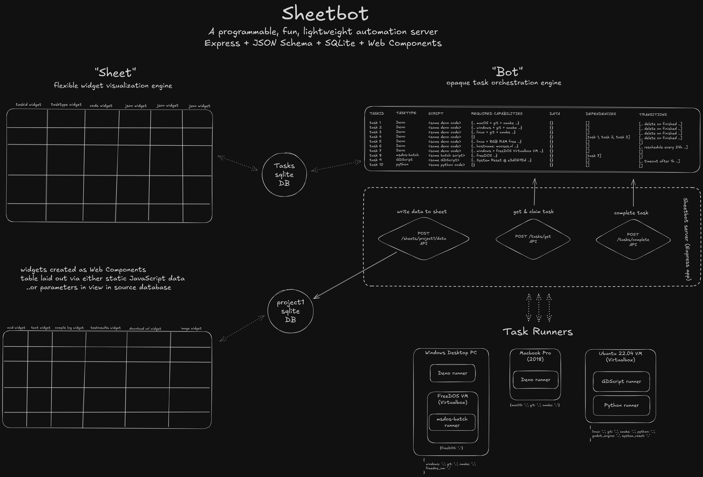

# Architecture

SheetBot keeps the server small and pushes execution and visualization outward. The server owns task state and matching; agents execute opaque scripts; the browser renders sheets and widgets.

## Components

- **HTTP server** — an Express app that exposes the task, sheet, artefact, library, script, and widget endpoints. It also serves the web UI.
- **SQLite storage** — `tasks.db` for tasks and transitions, `users.db` for users and permissions, and one database per sheet.
- **Agents** — external processes that poll for tasks matching their type and capabilities. Agents can be written in Deno, Node.js, Python, Bash, or a custom runtime.
- **Web UI** — Lit-based Web Components that render sheets, task tables, and widgets in the browser.
- **Artefacts** — files stored under `artefacts/` and exposed through task endpoints and an S3-compatible API.
- **Initialization and extensions** — startup scripts, library scripts, middleware, event handlers, and additional static/search paths let you extend a deployment without forking the server.

## Task flow

1. A user or script creates a task with a script, type, data, capabilities schema, and optional transitions.
2. An agent polls `/tasks/get` with its type and capabilities.
3. The server matches the task and returns its script URL.
4. The agent accepts the task, runs the script, and reports completion or failure.
5. The server updates the task, emits events, and evaluates transitions.

See [Protocol](../reference/protocol.md) for the exact sequence and state machine, and [Agent workflow](agent-workflow.md) for the agent side.

## Design choices

- **Opaque scripts** — SheetBot does not parse task scripts. Runners decide how to execute them.
- **JSON Schema matching** — capabilities are compared with a task's schema, so routing is flexible and language-agnostic.
- **SQLite first** — tasks, users, and sheets work without an external database service.
- **Browser-side rendering** — sheets and widgets are rendered in the viewer, keeping server compute low.
- **Configuration as code** — init scripts, library scripts, middleware, and event handlers are loaded from directories or environment variables.

## Where to go next

- [Extensibility](extensibility.md) — choose an extension point.
- [Agent runtime API](../reference/agent-runtime.md) — implement a custom runner.
- [Sheet database](../reference/sheet-database.md) — understand the storage layout.
- [Deploy SheetBot](../how-to/deploy-sheetbot.md) — run it as a service and back it up.
- [Debug a failed task](../how-to/debug-failed-tasks.md) — diagnose task and agent failures.
